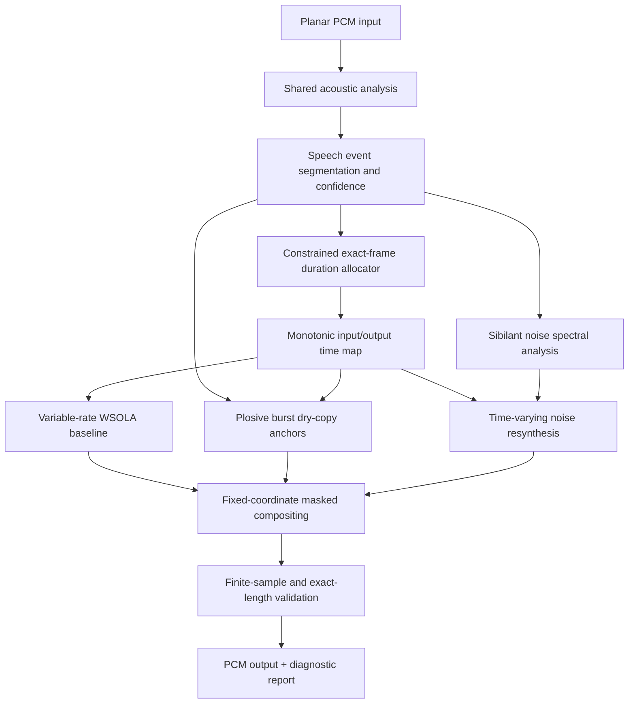

# SABLE: Speech-Adaptive Budgeted Lengthening Engine

**Technical specification for a Rust implementation**  
**Version:** 0.1 (proposed design)  
**Status:** Implementation brief; algorithm requires empirical evaluation  
**Primary deliverable:** Pure-Rust, offline, pitch-preserving speech time-scale modification library and CLI

> **Instruction to the coding agent:** Implement this specification incrementally. Prioritize the hard output-length invariant over local acoustic preferences. Do not silently replace the proposed hybrid algorithm with a generic phase vocoder, resampler, or uniform WSOLA. Where a detector is uncertain, use the documented conservative fallback and emit diagnostics. Keep all DSP code independently testable.

## 1. Goal

Create a speech-oriented time stretcher that treats different phonetic events differently:

1. **Plosives:** preserve the short release burst without repetition or temporal smearing; give the preceding closure and following aspiration their own nonlinear timing rules.
2. **Sibilants:** instead of repeating audible noise grains, resynthesize their sustained aperiodic component from a time-varying spectral envelope, with fresh deterministic noise excitation. Preserve voiced energy where applicable.
3. **Voiced speech:** stretch or compress predominantly periodic regions using variable-rate waveform-similarity overlap-add (WSOLA), preserving perceived pitch and formants as far as the method permits.
4. **Timing:** reconcile every local decision against one **sample-exact global duration budget**.

The proposed differentiator is the *combination* of speech-event policies, transient anchoring, noise resynthesis, and exact constrained duration allocation. The individual techniques have prior art; this document does not assert patentable or research novelty.

### Non-goals for v0.1

- Pitch shifting, voice conversion, transcription, ASR, or phoneme labeling.
- Musical/polyphonic time stretching as a primary use case.
- Realtime/low-latency processing; design interfaces that could support it later.
- ML model downloads, GPU requirements, or any network services.
- Magic restoration of information at extreme compression. Sample-exact duration takes priority when constraints conflict.

## 2. Definitions and non-negotiable invariants

- Input has `N_in` **sample frames**, each frame containing all channels, at sample rate `Fs`.
- **Stretch factor** `r = duration_out / duration_in`. Thus `r > 1` is longer/slower and `0 < r < 1` is shorter/faster. This is intentionally not the inverse "tempo" convention used by some libraries.
- For exact rational `r = p/q`, where `p, q` are positive integers:

  `N_out = floor((N_in * p)/q + 0.5)` (ties round upward).

  Implement with checked `u128` arithmetic, including the rounding addition; never derive the authoritative target from floating-point seconds.
- **Hard invariant:** output has exactly `N_out` sample frames in *each* channel, with the same `Fs` and number/order of channels. Never satisfy this merely by appending silence or truncating a wrongly sized render.
- In v0.1, accept any **positive rational factor** for which the checked target frame count fits configured memory/output limits, with an initial **audio-quality target** of `1/2 <= r <= 2`. Outside that quality range, emit `ExtremeStretchFactor` and allow documented degradation/fallback, but still satisfy the exact-frame contract. If a nonempty clip rounds to zero output frames, return a typed `OutputTooShort` error rather than silently fabricating audio. Support 8,000–96,000 Hz, mono and stereo, finite planar `f32` PCM. Empty input produces empty output.
- `r == 1` returns sample-identical audio (including signed zero where present). No analysis, normalization, resynthesis, or dither on this fast path.
- In valid nonempty input, all output samples must be finite. No hidden sample-rate changes or systematic pitch shift.
- Deterministic output and diagnostics for a given input, configuration, RNG seed, build, and platform.

**Example:** `N_in = 48_000` at 48 kHz and `r = 3/2` gives exactly `72_000` output frames, even though a stop burst inside the recording may still last exactly its original 480 frames.

## 3. Processing architecture



Use a **two-pass offline design**. First analyze and allocate durations, then synthesize into a preallocated `N_out`-frame buffer. All subsystems share one immutable sample-frame time map. The plosive and sibilant passes **replace/blend content at fixed output coordinates**; neither pass inserts or deletes frames.

## 4. Analysis and event model

### 4.1 Features

Use a shared, analysis-only mono reference (`0.5*(L+R)` where appropriate, with an energy-preserving fallback if L/R cancel). All channels retain their original PCM for rendering.

Compute the following, with window and hop sizes specified in milliseconds and converted to integer samples for each `Fs`:

| Feature | Starting default | Purpose |
|---|---|---|
| Frame hop | 5 ms | Boundary placement and envelope tracking |
| Short-frame RMS / log RMS | 20 ms | Pauses and closure valleys |
| FFT magnitude / power | ~20–32 ms, nearest suitable power of two | Spectral signatures |
| Positive spectral flux | Adjacent feature frames | Abrupt releases / onsets |
| High-frequency energy ratio | Adaptive high band, approximately 2.5 kHz to Nyquist | Frication detection |
| Spectral centroid and high-band flatness | Same FFT | Noise versus pitched excitation |
| Autocorrelation periodicity and candidate F0 | 30–45 ms; 65–450 Hz | Voiced versus unvoiced |
| Zero-crossing rate | 20 ms | Auxiliary unvoiced evidence, never sole decision |

Avoid absolute loudness thresholds alone. Estimate the local noise floor and energy distribution; support quiet recordings. Optional high-pass filtering for *analysis* must not alter original audio. Normalize spectral flux by local frame energy. All detectors must avoid division by zero and handle silence.

### 4.2 Nonoverlapping output of segmentation

Generate sorted, half-open, nonoverlapping input intervals `[start, end)` that partition `[0, N_in)` and carry a classification, confidence, and optional anchor. Types:

- `Voiced`: predominantly periodic vowels, sonorants, and stable voiced material.
- `SibilantUnvoiced`: sustained /s/, /ʃ/, etc. with convincing aperiodic high-frequency energy.
- `SibilantVoiced`: e.g., /z/, /ʒ/; harmonic low band plus aperiodic high band.
- `PlosiveClosure`: short energy reduction or occlusion preceding a candidate release.
- `PlosiveBurst`: brief release transient, including its immediate onset; hard timing anchor.
- `Aspiration`: post-burst breath/noise, distinct from a sustained sibilant.
- `Transition`: coarticulation, uncertain mixed speech, short boundaries.
- `Silence`: pauses and near-silence.
- `Other`: low-confidence or unsupported material.

This is **acoustic event recognition, not guaranteed phoneme recognition**. A heuristic state machine with hysteresis and minimum durations is sufficient for v0.1; provide a clean detector interface for eventual replacement.

### 4.3 Event detection rules

**Plosive hypothesis:** look for a short, high-positive-flux broadband onset, preferably preceded by a lower-energy closure region of approximately 10–120 ms. A burst is usually short (initial search width 2–15 ms). Protect an event only when corroborating cues exceed confidence threshold, because an onset of a stressed vowel or a tap can otherwise be misidentified. Closure detection is optional if there is no clear valley. Treat aspiration following the burst as a separate region rather than indiscriminately classing all noisy material as sibilant.

**Sibilant hypothesis:** require sustained high-band energy, relatively flat/noise-like high-band spectrum, no interior impulse dominating the event, and a stationary core of at least 40 ms. Use hysteresis at onset/offset. Voiced sibilants also exhibit periodic lower-frequency energy. If confidence is low, or the putative sibilant has no sufficiently long interior after edge guards, do **not** resynthesize it.

**Segmentation cleanup:** merge isolated tiny regions (initial threshold ~10 ms), except a well-supported burst. Do not merge away a burst anchor. Prefer conservative `Transition`/`Other` classifications to confident but wrong phoneme labels. Record detection scores and the reason each special renderer was enabled or disabled.

## 5. Exact-duration allocator (most important subsystem)

For each interval `i`, store input length `L_i`, preferred local stretch `a_i`, admissible output frame limits `lo_i, hi_i`, and a *compliance* `c_i` representing willingness to absorb extra duration. Let preferred (real-valued) output length be `P_i = L_i * a_i`.

### 5.1 Initial class-dependent policies

The following are **tunable starting hypotheses**, not psychoacoustic facts:

| Event | Preferred local factor `a_i` | Allowed factor range (stage A) | Compliance |
|---|---|---|---|
| `PlosiveBurst` | `1.0` | `[1.0, 1.0]` | `0` |
| `PlosiveClosure` | `1 + 0.12*tanh(2*(r-1))` | `[0.85, 1.15]` | `0.05` |
| `Aspiration` | `1 + 0.50*(r-1)` | `[0.65, 1.65]` | `0.30` |
| `SibilantUnvoiced` or `SibilantVoiced` | `1 + 0.65*(r-1)` | `[0.55, 2.50]` | `0.70` |
| `Voiced` | `r` | `[0.40, 3.00]` | `1.00` |
| `Transition`/`Other` | `1 + 0.80*(r-1)` | `[0.55, 2.40]` | `0.60` |
| `Silence` | `1 + 1.25*(r-1)` | `[0.25, 3.00]` | `1.50` |

Clamp preferred factors to their allowed ranges. Compute integer lower/upper bounds from each range, while allowing at least one frame per nonempty segment where feasible. Convert durations only after the full input partition is finalized. Distinguish *preferred* duration from *hard* bounds; changing one does not silently change the other.

The burst rule makes plosive timing **locally nonlinear**: the burst is copied at 1x, the closure changes only mildly, and voiced or pause regions pay back the duration difference. The closure formula saturates instead of following the global rate linearly.

### 5.2 Weighted constrained allocation

Find real durations `d_i` satisfying `sum_i(d_i) = N_out`, subject to `lo_i <= d_i <= hi_i`, while minimizing departures from the class preferences. Use a single Lagrange multiplier:

```text
affordance_i = max(epsilon, L_i * c_i)  // zero for truly fixed bursts

d_i(lambda) = clamp(P_i + lambda * affordance_i, lo_i, hi_i)
```

Binary-search `lambda` until the real-valued sum is sufficiently close to `N_out`. Only apply this method when `sum(lo_i) <= N_out <= sum(hi_i)`. Fixed regions contribute constant durations. Weighting by `L_i` distributes correction across available material, rather than dumping it into one vowel.

**Integerization:** floor the resulting real `d_i`, then distribute remaining integer frames to intervals with available headroom, prioritizing largest fractional remainders. If floating-point tolerances cause a surplus, remove frames from intervals above their minimum, prioritizing smallest fractional remainders. The final integer vector `D_i` **must** satisfy:

```text
sum(D_i) == N_out
lo_i <= D_i <= hi_i
D_i is an integer
```

Use explicit checks and deterministic tie-breaking by segment index. Implement the allocator separately from DSP and exhaustively unit-test it with generated partitions.

### 5.3 Infeasible budgets and priority ordering

An all-transient clip cannot both keep *every* transient at 1x and become twice as long. Do not claim otherwise.

1. **Stage A:** use the normal bounds above.
2. **Stage B:** if infeasible, widen non-burst bounds substantially while keeping burst durations fixed. Emit `RelaxedNonBurstBudget`.
3. **Stage C:** if still infeasible, relax burst protection as well, allowing any nonempty interval a sufficiently broad positive frame budget; emit `BurstProtectionWaived` with affected event IDs. Ensure the segment count does not exceed `N_out` by coalescing short non-anchor regions, or use the last-resort whole-clip fallback on degenerate input.
4. **Stage D:** if classification/allocation remains invalid, use a single whole-clip uniform time map and the generic safe renderer for exactly `N_out` frames. Emit `UniformFallback`. Do not return the wrong length.

When plosive `D_i != L_i` due to relaxation, do not use an incorrectly aligned 1x dry-copy overlay for it. Make this degradation visible in the report.

### 5.4 Shared monotonic time map

Build integer cumulative boundaries:

```text
S_0 = 0;  S_{i+1} = S_i + L_i
O_0 = 0;  O_{i+1} = O_i + D_i
S_last = N_in; O_last = N_out
```

For most segments, start with the piecewise linear input-to-output map:

`T(x) = O_i + (x-S_i) * (D_i/L_i)`.

**Plosive-phase nonlinear warp (required for v0.1):** Let `v = (x-S_i)/L_i`, `a = D_i/L_i`, and define the endpoint-preserving curved map:

```text
F(v; k) = v + k*v*(1-v)              // F(0)=0, F(1)=1
T_i(x) = O_i + D_i*F(v; k)
```

Use `k = clamp(1 - 1/a, -0.9, 0.9)` for a `PlosiveClosure` immediately **before** its burst, so `dT/dx` approaches 1 at the release boundary whenever the unclamped value is feasible. Use `k = clamp(1/a - 1, -0.9, 0.9)` for `Aspiration` immediately **after** a burst, so `dT/dx` starts at 1 at the release boundary. This tapers time compression/expansion away from the acoustically decisive burst, instead of abruptly switching slopes at the onset. Use the ordinary linear map if the phase is not adjacent to a confidently detected burst.

Because `|k| < 1`, `F'(v) = 1 + k*(1-2*v)` remains positive. These curved maps preserve *exactly the same interval boundaries and output-frame allocations* as the straight ones. When clamping prevents a 1x edge derivative, record `WarpSlopeRelaxed`. WSOLA must evaluate the inverse `U(y)` of the appropriate local map; obtain it by a stable quadratic inversion or bounded monotonic bisection, **not** by assuming the entire map is linear.

WSOLA queries `U(y)` to map desired output positions to expected input positions. The map is monotonic, endpoint-exact, and shared by all channels. If a segment is zero-length after an emergency fallback, skip it explicitly; never divide by zero. Later versions may smooth derivatives at other class boundaries, but **must not move the exact boundary anchors**.

## 6. Baseline synthesis: variable-rate WSOLA

Implement the reference, always-available synthesis path before adding special rendering.

1. Preallocate output accumulation and weight buffers, each exactly `N_out` frames per channel.
2. Use initially ~32 ms Hann-weighted grains, ~8 ms synthesis hop, and a search radius of approximately +/-8 ms (all tunable). Maintain padded/reflective input reads at file ends.
3. For output grain center `y_j`, predict source center `u_j = U(y_j)`. Search around `u_j` for a candidate matching the **already synthesized overlap**, using normalized cross-correlation. Score on the shared mono reference and apply the *same selected grain positions* to all channels, preserving interchannel alignment.
4. Constrain search to avoid jumping across a protected burst anchor; reduce window/hop/search sizes near transients, and use fixed predicted positions if no safe candidate exists. Prefer forward source progression. If overlap energy is negligible, choose the predicted source position without an unstable correlation calculation.
5. Overlap-add Hann-weighted grains. Divide by accumulated window weights wherever nonzero. Choose frame centers/padding so the first and final output frames have valid coverage; fill any provable uncovered samples by the deterministic safe fallback, not by appending silence.
6. Use **no resampling of speech frames as a shortcut to time stretching**. Ordinary input-position interpolation alone changes pitch.

The generic renderer needs an independent exact-length test suite. Treat onset protection inside WSOLA as a *supporting defense*, because the plosive overlay below provides the final burst-preserving path.

## 7. Plosive renderer: anchored dry event

For each confident `PlosiveBurst` with `D_i == L_i`:

1. Map its exact output onset `O_i` to original onset `S_i`.
2. Copy the release/burst samples **one-to-one** from source to a temporary event buffer; do not repeat, skip, grain-stretch, or pitch-shift these samples.
3. Extend the event buffer with original contextual audio, provisionally ~4 ms pre-burst and ~6 ms post-burst, within file bounds. The output-time sample at `O_i + k` must read source-time sample `S_i + k` for the protected core. The extended neighborhood may overlap adjacent interval coordinates but must not alter their lengths.
4. Mix with the WSOLA baseline using a raised-cosine **constant-sum** crossfade in the context wings. Event weight is 1.0 for the complete protected burst core and 0 outside the wings. Crossfade must occur *outside*, not through, the decisive release impulse wherever there is enough context.
5. If adjacent protected bursts have overlapping wings, shorten the wings deterministically or prioritize the higher-confidence event; never double-add both.

Do not globally lock the entire closure or all aspiration. A stop has distinct closure, burst, and post-burst phases, and their timing policy must remain separate.

## 8. Sibilant renderer: time-varying noise resynthesis

### 8.1 Scope and fallback

Operate only on confident `SibilantUnvoiced` or `SibilantVoiced` regions with a sustained interior of at least ~40 ms after excluding onset/offset guards (initially 10 ms each). Very short, bursty, low-SNR, or ambiguous regions retain the WSOLA baseline. A brief noisy plosive release must **not** be expanded into a new long /s/.

### 8.2 Capture a source spectral-noise template

- Analyze source segment using ~20–32 ms sqrt-Hann STFT windows and ~5 ms feature hop.
- Compute auto-power spectra `P_ch(t,k) = E[|X_ch(t,k)|^2]`, temporally smoothed around ~20–30 ms and smoothed in frequency using approximately 1/6-octave (or perceptual-band) neighborhoods. Do the smoothing in power or log-power with well-defined floors; ensure isolated voiced harmonics are not blindly copied as narrow spectral spikes into the noise profile.
- Preserve **time-varying** spectral tilt, center frequencies, high-band emphasis, and RMS envelopes. Do not replace /s/ or /ʃ/ with identical white-noise templates.
- For stereo, also estimate a smoothed cross-spectrum, `C_RL(t,k) = E[X_R(t,k) * conj(X_L(t,k))]`, and regularize coherence estimates where power is tiny.
- Sample these features along the inverse segment time map as output time advances. Interpolate the feature envelopes, rather than looping original noise samples.

### 8.3 Synthesize new noise, not repeated grains

For every output STFT center in the segment:

1. Obtain the interpolated desired spectrum from source feature time `U(y)`.
2. Generate seeded zero-mean unit-variance complex Gaussian excitation independently across positive-frequency bins and time frames; treat DC/Nyquist as real. Use a deterministic, local `ChaCha8Rng` stream keyed by global seed and segment ID. RealFFT synthesis must yield a real waveform.
3. Color the excitation by the square root of the target power spectrum. Correctly account for FFT normalization and analysis-window energy. The random excitation must have *new phases*, not repeating slices of source sibilance.
4. Inverse FFT each block, apply a synthesis window, overlap-add, and normalize the overlap for **independent stochastic grains** (e.g. using the square root of summed squared synthesis windows). Validate with stationary white and colored noise tests; do not blindly reuse a deterministic-signal overlap normalization that introduces periodic noise-level modulation.
5. Track the target time-varying RMS; apply smoothly changing bounded envelope calibration if needed. The default must not introduce pumping or boost a source-noise floor into audible hiss between words.

For stereo, preserve approximate spatial coherence rather than emitting two unrelated noise tracks. Given normalized complex correlation `rho = C_RL / sqrt(P_L*P_R)`, clamped to magnitude <= 1:

```text
Z_L = Z1
Z_R = rho*Z1 + sqrt(1 - |rho|^2)*Z2
X_L = sqrt(P_L)*Z_L
X_R = sqrt(P_R)*Z_R
```

where `Z1`, `Z2` are independent circular complex unit-variance Gaussian excitations. Handle DC/Nyquist as real special cases; use power floors to prevent numerical instability. This is a frequency-domain covariance model, not a perfect recreation of stereo ambience. If the stereo estimates are unstable, fall back to baseline WSOLA for that event.

### 8.4 Voiced versus unvoiced sibilants

- **Unvoiced:** replace the sustained interior principally with full-band spectral-noise resynthesis, preserving naturally low-energy bands through the captured spectrum.
- **Voiced:** keep WSOLA's harmonic lower-frequency component; replace only the aperiodic high-frequency component. Begin with a smooth, complementary transition band of approximately 2–4 kHz, adjusted for sample rate. Implement the split with measured, delay-compensated FIR filters or equivalent stable spectral masks. `lowpass(baseline) + highpass(resynthesized_noise)` must reconstruct smoothly; no accidental crossover gain bump or delay.
- In both cases, retain the baseline at the event boundaries and fade toward the synthetic interior. Do not overwrite the beginning of a following vowel or the transient of an adjacent stop.

### 8.5 Fixed-length compositing

Generate a candidate sibilant buffer covering the event's **already allocated** output interval `[O_i, O_{i+1})`. Apply raised-cosine entry/exit crossfades inside the interval, leaving ~10 ms boundary guards where possible. Because generated noise is approximately uncorrelated with the WSOLA baseline, prefer **equal-power** fades (`cos(theta)`, `sin(theta)`) and check for perceived level jumps. The event does not add output frames. In case of overlapping event masks, confident plosive protection wins; otherwise disable the weaker special renderer.

## 9. Composition, numerical behavior, and safety

1. Start with the baseline of exactly `N_out` frames.
2. Apply plosive overlays at fixed coordinates.
3. Apply nonoverlapping sibilant overlays at fixed coordinates, never overwriting protected bursts.
4. Validate sample finiteness and output dimensions. Internal FFT/iFFT transforms must explicitly normalize the inverse by the FFT length (the `realfft`/`rustfft` families do not do this automatically).
5. Keep floating-point PCM in `f32`, optionally using `f64` for feature statistics, duration solving, and accumulation. Do not run a global loudness normalizer, hard limiter, or noise gate by default.
6. WAV integer export may clip/sample-quantize; provide float WAV output by default, and document any explicit integer conversion/dither option separately.
7. Silence input must produce *exact* zeros at every stretch factor; resynthesis must not fabricate noise in silence.
8. In diagnostics include the requested ratio, exact frame counts, segment table with local ratios, detector scores, allocator relaxation stage, synthesis fallback flags, and peak/RMS before/after.

**Never repair length after synthesis with an unreported truncate/pad operation.** It is acceptable for a fixed-size overlap-add accumulator to ignore window contributions outside its preallocated frame range as part of normal rendering; it is not acceptable to render the wrong duration and slice off phonetic content to meet the API contract.

## 10. Rust interface and file layout

### 10.1 Library API (illustrative, adapt naming without changing semantics)

```rust
use std::num::NonZeroU64;

#[derive(Clone, Copy, Debug)]
pub struct StretchRatio {
    pub numerator: u64,
    pub denominator: NonZeroU64,
}

pub struct AudioView<'a> {
    pub sample_rate: u32,
    pub channels: &'a [&'a [f32]], // planar, equal-length channels
}

pub struct AudioBuffer {
    pub sample_rate: u32,
    pub channels: Vec<Vec<f32>>, // planar
}

pub struct Options {
    pub seed: u64,
    pub quality: QualityPreset,
    pub diagnostics: bool,
}

pub struct ProcessResult {
    pub audio: AudioBuffer,
    pub report: AnalysisReport,
}

pub fn stretch(
    input: &AudioView<'_>,
    ratio: StretchRatio,
    options: &Options,
) -> Result<ProcessResult, StretchError>;
```

Provide `StretchRatio::from_decimal_str("1.25")` and `StretchRatio::from_fraction_str("5/4")` without introducing an uncontrolled floating-point duration error. Reduce fractions by GCD, reject zero numerator and denominator, and compute target frames with checked `u128` arithmetic. A convenient `f64` API can be added later, but its rounding semantics must be explicit.

### 10.2 Suggested workspace structure

```text
sable/
  Cargo.toml
  README.md
  SABLE_SPEC.md
  crates/
    sable-core/
      src/
        lib.rs
        audio.rs
        ratio.rs
        features.rs
        detect.rs
        segments.rs
        budget.rs
        timemap.rs
        wsola.rs
        plosives.rs
        sibilants.rs
        stereo.rs
        windows.rs
        report.rs
    sable-cli/
      src/main.rs
  tests/
    duration_properties.rs
    synthetic_events.rs
    integration_audio.rs
  benches/
    speech.rs
  examples/
    inspect_events.rs
```

Suggested audited dependencies, as of October 2026:

- `realfft` 3.5 family (built on `rustfft` 6.x) for real STFT and inverse STFT. Be precise about explicit FFT scaling.
- `hound` 3.5 family for first-version WAV PCM input/output.
- `rand_chacha` 0.10 family for reproducible noise excitation. Use its matching `rand_core` version; do not copy outdated `rand` trait imports from earlier major versions.
- `clap`, `serde`, `serde_json`, and `thiserror` where needed; pin mutually compatible released versions after checking the actual Cargo resolution.
- Optional later: `symphonia` for compressed-format decoding, outside the DSP core.

No FFI dependency on Rubber Band or other proprietary/external DSP engines. Reference implementations may be used *only* as offline quality baselines for evaluation. Keep the core portable and `unsafe`-free unless a benchmark demonstrates a concrete reason otherwise.

### 10.3 CLI contract

```sh
sable --input speech.wav --output stretched.wav --stretch 3/2
sable --input speech.wav --output faster.wav --stretch 0.75 \
  --seed 42 --diagnostics events.json
```

`--stretch` means `duration_out / duration_in`, matching the library. Print source frames, target frames, actual frames, actual achieved factor, and relaxed-constraint warnings. Output sample rate and channel count unchanged. Error on malformed/unsupported input; do not silently downmix stereo.

## 11. Tests and evaluation

### 11.1 Required automated unit/property tests

- **Length:** for randomly generated `N_in`, positive rational factors (especially `[1/2,2]` and selected extremes such as `1/4` and `4`), and event partitions, `len(output[ch]) == N_out` on all channels. Test allocator integer bounds, sum, monotonic linear/curved maps, correct 1x derivatives next to bursts, stable inverse mapping, overflow, many sub-20-ms segments, all-burst clips, all-silence, and events at first/last sample.
- **Identity:** `r=1` is sample-identical for mono/stereo finite input.
- **Silence:** all-zero input remains all-zero for every factor.
- **Safety:** NaN/Inf inputs, unequal channel lengths, invalid sample rates/ratios, nonempty clips with zero rounded output frames, and impossible output sizes produce typed errors rather than panic or undefined behavior.
- **Determinism:** same seed and configuration yield identical samples and reports within a given build/platform.
- **Allocator relaxation:** deliberately infeasible fixed-burst cases still produce the exact requested length and a correct diagnostic flag.
- **Boundary normalization:** no uncovered samples or periodic window-gain modulation in noise-only synthesis; exact final frame coverage.

### 11.2 Synthetic DSP regression fixtures

Create fixtures programmatically, not from copyrighted recordings:

1. **One stop release:** quiet closure, one short noise impulse/burst, short aspiration, and a voiced vowel. For non-relaxed events, confirm exactly one protected release at the mapped onset, with no secondary comparable release peak.
2. **Voiced harmonic vowel:** synthetic harmonic source with changing envelopes/formants at 80, 140, and 250 Hz F0. After time stretching, estimate median F0; target error below ~2% in steady portions (exclude edges).
3. **Unvoiced /s/-like noise:** high-band shaped stationary noise with an amplitude envelope. Compare the time-mapped source/output power spectra across populated frequency bands; initial target median absolute band deviation <= 3 dB, and no conspicuous periodic repetitions.
4. **/ʃ/-like noise:** distinct lower spectral concentration; ensure it is not synthesized using the /s/ profile.
5. **Voiced /z/-like noise:** voiced low-frequency periodic component plus high-frequency noise; ensure low-band F0 survives while upper-band noise changes excitation.
6. **Stereo sibilance:** coherent, panned and partially decorrelated stereo noises; report output channel energy ratio and bandwise coherence drift.
7. **Extreme transitions:** a sibilant next to a plosive, burst at file start/end, whispered speech, background hiss, and ~50-ms input.

Test stretch factors `0.5, 0.65, 0.75, 0.9, 1.0, 1.1, 1.25, 1.5, 1.8, 2.0` at 8, 16, 44.1, 48, and 96 kHz where feasible.

### 11.3 Listening and objective comparisons

Maintain versioned A/B samples using Spanish and English speech, with both male and female pitches, varied recording levels, whispering, fast speech, and noisy material. Compare at minimum against (a) the generic WSOLA implementation with all special handling disabled, and (b) an external high-quality baseline such as Rubber Band. Listening prompts: doubled /t/ or /k/, smeared attack, robotic /s/, cyclic hiss, missing fricative, vowel warble, changed F0, click at event edge, unbalanced stereo image. No single automatic metric establishes perceptual success.

Do not imply experimental quality targets are already met. Track measurements and listening decisions in `QUALITY.md` once implementation exists.

## 12. Milestones and definition of done

**M0: Skeleton and timing contract.** Rust workspace, PCM/WAV IO, ratio parser, checked target-frame calculation, independently tested constrained integer allocator, typed errors, identity and silence paths.

**M1: Analyzer.** Acoustic feature extraction, conservative segmenter, anchor/confidence model, and JSON inspection output. Include synthetic plosive and fricative detector fixtures.

**M2: Generic stretcher.** Shared time map and variable-rate mono/stereo WSOLA, correctly normalized output, exact-length integration and F0 tests.

**M3: Plosive handling.** Per-class local nonlinear duration preferences, protected bursts, copy/composite logic, detector confidence fallback, no duplicate release on synthetic tests.

**M4: Sibilant handling.** Time-varying spectrum estimator; deterministic colored-noise synthesizer; unvoiced then voiced hybrid mode; stereo covariance handling; no periodic repeats on synthetic tests.

**M5: Integration and verification.** CLI diagnostics, automated quality suite, human A/B test set, benchmarks, documentation of performance and known artifacts, CI on macOS/Linux/Windows.

**Acceptance criteria for v0.1:**

- The library and CLI build and run on stable Rust without a model or network connection; explicitly report factors outside the tested quality range.
- All supported valid inputs return precisely `N_out` frames per channel, including relax/fallback paths.
- Identity is sample-exact; silence stays silent; error handling is explicit.
- Plosive anchoring and sibilant replacement are demonstrated by meaningful automated tests **and** inspectable intermediate diagnostic files.
- Typical voiced speech does not incur the pitch change associated with naive resampling.
- The special algorithms improve at least representative listening cases relative to generic WSOLA, with shortcomings documented instead of concealed.
- Provide a README, API docs, example WAV processing, and a short report on quality and performance.

## 13. Risks and policy decisions

- **Detection errors:** a false stop classification may overwrite a vowel onset; a false sibilant may generate hiss. High confidence thresholds and bypass paths are mandatory.
- **Acoustic limitations:** a dry burst plus over-stretched vowels can sound rhythmically unnatural, even if sample length is correct; tuning requires listening.
- **Harmonic leakage:** voiced fricatives require a robust low/high-frequency split; otherwise /z/ becomes /s/ or gains robotic harmonics.
- **Time-map boundaries:** abrupt local changes can cause seam artifacts. Smooth with context fades and later improved constrained warps, never by moving output anchors.
- **Covariance model:** stereo noise covariance is an approximation. Detect instability and fall back rather than emitting an erratic spatial image.
- **Exactness versus naturalness:** if budget constraints conflict, report which protection was relaxed. No renderer may override exact output frame count.

## 14. References and technical grounding

These support underlying techniques and library choices; they are **not** claims that the complete SABLE design has been implemented or validated elsewhere.

- Driedger & Müller, *A Review of Time-Scale Modification of Music Signals*. Includes WSOLA and discussion of preserving detected transients by copying them unchanged and compensating elsewhere: https://www.mdpi.com/2076-3417/6/2/57
- `pyrubberband.timemap_stretch`: source/output sample-frame time mapping and endpoint behavior: https://pyrubberband.readthedocs.io/en/latest/generated/pyrubberband.pyrb.timemap_stretch.html
- `librosa.phase_vocoder`: documentation explicitly notes transient limitations of a minimal phase vocoder: https://librosa.org/doc/main/api/generated/librosa.phase_vocoder.html
- Jongman, Wayland & Wong, *Acoustic characteristics of English fricatives*: https://pubmed.ncbi.nlm.nih.gov/11008825/
- University of Hong Kong / Education University of Hong Kong acoustic consonant overview (closure, compression, release): https://corpus.eduhk.hk/english_pronunciation/index.php/3-2-acoustic-aspects-of-consonants/
- `realfft` docs and FFT scaling: https://docs.rs/realfft/latest/realfft/
- `hound` docs: https://docs.rs/hound/latest/hound/
- `rand_chacha` docs: https://docs.rs/rand_chacha/latest/rand_chacha/
- `symphonia` docs (future decoder option): https://docs.rs/symphonia/latest/symphonia/

---

**Instruction on implementation trade-offs:** A simple, inspectable, well-tested detector with conservative bypass behavior is preferable to speculative phonetic labeling. A correct exact-duration allocator is preferable to a superficially convincing rendering that misses the required output length. Implement the algorithm in that order.
