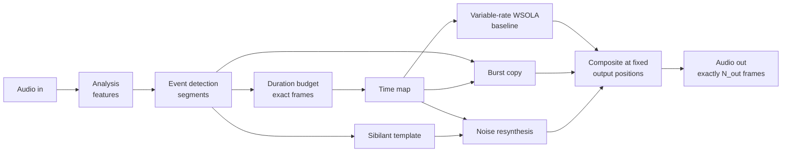

# How SABLE works

SABLE (Speech-Adaptive Budgeted Lengthening Engine) makes speech longer or shorter without
changing its pitch. It does not stretch every part of a recording the same way. It
first finds out *what kind of sound* is happening at each moment, gives each kind its
own treatment, and then makes sure the pieces add up to **exactly** the requested length,
down to the single sample.

This document explains the whole chain, from file to file. The specification is
[`SABLE_SPEC.md`](../SABLE_SPEC.md). The measured results are in [`QUALITY.md`](../QUALITY.md).
The trade-offs, including where the method fails, are in [`COMPROMISES.md`](COMPROMISES.md).

---

## 1. The problem

Time stretching speech by a factor *r* (1.5 = 50 % longer) has two classic failure
modes:

* **Resampling** (playing faster or slower) changes the length, but it shifts the pitch
  with it.
* **Uniform overlap-add methods** (WSOLA, phase vocoders) keep the pitch. But they treat
  all sound the same, so:
  * the sharp *release* of a stop like /p t k/ gets smeared, or repeated (a doubled "t");
  * a long /s/ is made of noise, so repeating chunks of it produces audible "robotic"
    patterns;
  * pauses and vowels stretch as much as everything else.

Phonetically, people do not slow down evenly either. Vowels and pauses absorb most of a
tempo change, while the burst of a stop stays about the same length.

SABLE's approach combines four mechanisms:

1. **Detect** the acoustic events: pauses, vowels, stop closures, stop bursts,
   aspiration, and sibilants (/s ʃ z/).
2. **Budget** the exact output length across those events. Each kind has its own
   preferred stretch and limits, and the solution must add up exactly.
3. **Render** the bulk with variable-rate WSOLA that follows that budget.
4. **Replace** two event types at fixed positions: stop bursts are copied unstretched,
   and sustained sibilants are re-synthesized as new noise.



Nothing after the budget step can change the length. The overlays write *into* an output
buffer that already has the final size.

---

## 2. The length contract

For a factor `r = p/q` (an exact fraction; `1.25` is parsed as `5/4`, never as a float):

```
N_out = floor(N_in · p / q + 1/2)        (ties round up)
```

It is computed in 128-bit integers as `k = (N_in·p) div q`, plus 1 if `2·(N_in·p mod q) ≥ q`,
so it cannot overflow and is never derived from seconds. Every channel of every successful
result has exactly `N_out` frames: normal runs, fallback runs, stereo and mono alike.
Special cases:

* `r = 1` returns the input bit for bit (signed zeros included).
* An all-zero input returns exact zeros.
* An empty input returns an empty output.
* Invalid input (NaN, unequal channel lengths, a sample rate outside 8–96 kHz) returns a
  typed error instead of crashing.

---

## 3. Analysis (`features.rs`)

All analysis runs on a single *reference* signal. Each channel's own audio is used only
for rendering.

* **Mono:** the signal itself.
* **Stereo:** the mid `(L+R)/2`. If the channels largely cancel (out of phase), the
  louder channel is used instead. When the side is a minor ambience layer (at least
  10 dB below the mid after time alignment), detection runs on a *dry-centre* estimate
  instead: the channels are time-aligned (GCC-PHAT), and the side's power is subtracted
  from the mid's in every short-time frequency bin. Reverb and room sound that are spread
  across both channels sit about equally in mid and side, so this keeps the brief
  silences before stops from filling with reverb tail.

Every **5 ms** a frame is analysed:

| Feature | Window | What it is for |
|---|---|---|
| RMS level (dB) | 20 ms | pauses, closures |
| Short-time spectrum | ≈ 25 ms (power of two) | everything spectral |
| Positive spectral flux | adjacent frames | sudden onsets |
| High-band ratio | energy above ≈ 2.5 kHz | frication (/s/) |
| Local spectral flatness | ≈ 500 Hz sub-bands above 2.5 kHz | noise (≈ 0.56) vs harmonics (low) |
| Periodicity and F0 | 40 ms, normalized autocorrelation (65–450 Hz) | voiced vs unvoiced |
| Low-band periodicity | same, below 1.5 kHz only | voicing under a /z/ |
| Zero-crossing rate | 20 ms | auxiliary |

A separate **1 ms envelope** of the pre-emphasised signal (high frequencies boosted) is
used for timing transients precisely.

Thresholds are *relative*. The noise floor is the 10th percentile of frame levels, and
speech level is the 95th. A frame is silent when it is far enough below speech and close
enough to the floor. Quiet and loud recordings are therefore handled the same way.

---

## 4. Event detection (`detect.rs`)

The output is a list of non-overlapping segments covering the whole input:

`Voiced`, `SibilantUnvoiced`, `SibilantVoiced`, `PlosiveClosure`, `PlosiveBurst`,
`Aspiration`, `Transition`, `Silence`, `Other`.

These are *acoustic* events, not phonemes. When unsure, the detector prefers
`Transition`/`Other`, which simply get ordinary stretching.

### 4.1 Frame labels

A small state machine with *hysteresis* labels each frame. Hysteresis means it takes
stronger evidence to enter a state than to stay in it, which prevents flickering:

* **Silence:** below the adaptive threshold.
* **Sibilant:** a strong high band (ratio > 0.55 to enter, > 0.42 to stay) and a
  noise-like high band (flatness > 0.30 / 0.20). For frames with periodic low-band
  voicing (a /z/), the high-band ratio is measured relative to energy above 1.5 kHz, so
  the voicing does not hide the frication.
* **Voiced:** periodicity > 0.60 to enter, > 0.45 to stay.
* **Unknown:** anything else.

Runs of equal labels become segments. A sibilant run shorter than 40 ms, a low-confidence
one, or one with an impulse inside it (a click 12 dB above its median) becomes
`Transition`/`Other`.

### 4.2 Stop bursts

A **candidate** is a jump of ≥ 15 dB in the 1 ms envelope, compared with the preceding
≈ 20 ms. Its onset is then located to the sample, at the first sample above 20 % of the
local peak.

Each candidate gets a **confidence**: the product of five soft factors, each a smooth
0–1 score. It is protected if confidence ≥ 0.5:

| Factor | Question | Why |
|---|---|---|
| jump | how abrupt is the onset? | bursts are sudden |
| aperiodicity | is the sound noise-like 5 ms after the onset? | a voiceless release or aspiration is noise; a vowel onset, tap or trill is already periodic |
| closure valley | was there a quiet closure before it (≈ 7 dB or deeper)? | stops are preceded by a closure |
| growth | does it dip after the release, **or** become voiced within 20–60 ms, **or** look like a sharp click? | /s/ and whispered vowels rise smoothly and stay noisy; stops do not |
| burst evidence | is there a 0.25 ms spike, or does the onset *add* mostly energy above 2 kHz? | the "added" energy is measured against the 4 ms just before, so a constant low rumble does not matter |

An accepted burst then gets neighbours:

* **Closure:** the quiet stretch just before it, 10–120 ms.
* **Burst:** the release itself, 2–12 ms, ending when the 1 ms level falls 10 dB below
  its peak.
* **Aspiration:** the following noisy, non-sibilant material, up to 60 ms.

The burst rules were tuned on hand-labelled examples; their accuracy and blind spots are
documented in [COMPROMISES §5](COMPROMISES.md). In short, they work well on clean speech.
They are conservative on noisy or reverberant recordings, and they miss voiced stops
(/b d g/) by design.

### 4.3 Clean-up

Segments shorter than 10 ms are merged into a neighbour, never into a burst. Adjacent
segments of the same class are joined.

---

## 5. The duration budget (`budget.rs`)

This is the core of the length guarantee. Each segment *i* has:

* an input length `L_i`;
* a **preferred** local factor `a_i`, so its ideal output length is `P_i = L_i · a_i`;
* **hard limits** `lo_i ≤ D_i ≤ hi_i` on its output length;
* a **compliance** `c_i`: how willing it is to absorb extra time.

Starting policies (spec §5.1):

| Event | Preferred factor | Allowed range | Compliance |
|---|---|---|---|
| Burst | 1 | exactly 1 | 0 |
| Closure | 1 + 0.12·tanh(2(r−1)) | 0.85–1.15 | 0.05 |
| Aspiration | 1 + 0.5(r−1) | 0.65–1.65 | 0.30 |
| Sibilant | 1 + 0.65(r−1) | 0.55–2.50 | 0.70 |
| Voiced | r | 0.40–3.00 | 1.00 |
| Transition / Other | 1 + 0.8(r−1) | 0.55–2.40 | 0.60 |
| Silence | 1 + 1.25(r−1) | 0.25–3.00 | 1.50 |

So at r = 1.5, a burst stays exactly as long, a closure grows only about 9 %, and
pauses grow more than vowels.

**Solving.** Find one number λ such that

```
D_i(λ) = clamp( P_i + λ · L_i · c_i ,  lo_i , hi_i )      and      Σ D_i(λ) = N_out
```

`Σ D_i(λ)` only increases with λ, so a bisection finds it. Weighting by `L_i · c_i`
spreads the correction over all the flexible material, instead of dumping it into one
vowel.

**Whole frames.** The real-valued `D_i` are rounded down. The few leftover frames go to
the segments with the largest fractional parts that still have room (ties broken by
position). This is deterministic, and the result is checked:
`Σ D_i == N_out` and every `D_i` is within its limits.

**When the budget is impossible.** For example, a clip made almost entirely of bursts
cannot become twice as long while every burst stays 1×. The limits are then relaxed in
documented stages, and each relaxation is reported:

* **A:** the table above.
* **B:** non-burst segments may take any length; bursts stay fixed.
* **C:** burst protection is waived as well. Those bursts are listed and get no 1× copy.
* **Coalescing:** if there are more segments than output frames, the shortest non-burst
  segments are merged.
* **D:** a single uniform stretch of the whole clip.

The length never changes; only the local preferences give way.

---

## 6. The time map (`timemap.rs`)

The budget gives each segment an input span `[S_i, S_i+L_i)` and an output span
`[O_i, O_i+D_i)`. Inside a segment, input time maps to output time linearly by default.

Around a protected burst, the map is **curved** so the transition to 1× is gradual:

```
T(x) = O_i + D_i · F(v),   v = (x − S_i)/L_i,   F(v) = v + k·v·(1 − v)
```

`F(0) = 0` and `F(1) = 1`, so the segment's start and end are unchanged. The slope at
either end is set by `k`:

* **Closure before a burst:** `k = 1 − 1/a`. The slope is exactly 1 where the closure
  meets the burst.
* **Aspiration after a burst:** `k = 1/a − 1`. The slope starts at exactly 1.

Here `a = D_i/L_i`. `|k|` is kept below 0.9 so the map is always increasing. If that
limit prevents a slope of exactly 1, a `WarpSlopeRelaxed` warning is reported.

The renderers need the opposite question: which input moment belongs to output
position *y*? That is the inverse `U(y)`, solved from the quadratic with a numerically
stable formula, `v = 2w / ((1+k) + sqrt((1+k)² − 4kw))`.

---

## 7. Baseline: variable-rate WSOLA (`wsola.rs`)

**WSOLA** (waveform-similarity overlap-add) builds the output from short overlapping
**grains** of the input, each faded in and out with a Hann window.

* Grains are 32 ms long, placed every 8 ms of *output* time.
* For an output grain at `y`, the expected source position is `U(y)`, from the time map.
* SABLE searches ±8 ms around that position for the spot whose waveform best continues
  what has already been written (normalized cross-correlation over the overlap). This
  lines up pitch periods, so no click or pitch change appears.
* The chosen position is used for **all channels**, so stereo stays aligned. A stereo
  pair is therefore rendered exactly as its mid and side would be.
* Stretching legitimately re-uses a pitch period, so the source may step back by up to
  one grain hop. A strict "always forward" rule was measured to drop the pitch by 12 % at
  80 Hz.
* Near a protected burst (±20 ms), grains shrink to 12 ms, a 3 ms hop and a ±2 ms search,
  and a grain may not straddle the burst onset unless its predicted position already
  does.
* Output = Σ(window × grain) ÷ Σ(window), into a buffer of exactly `N_out` frames.

Grain positions follow the time map, so WSOLA stretches each segment by its own budgeted
amount. That is the "variable rate".

---

## 8. Stop bursts: anchored copy (`plosives.rs`)

For each protected burst whose budgeted length is still exactly 1×:

* output frame `O_i + k` receives input frame `S_i + k`, one to one, for the whole burst.
  The burst plays back bit-identical to the original, exactly once, at its mapped
  position;
* 4 ms of original context before it and 6 ms after it are crossfaded with the WSOLA
  output (raised-cosine, weights summing to 1). The fade happens *around* the burst, never
  through it;
* if two bursts are close, their context wings are shortened to meet in the middle;
* a burst whose length had to change (stage C) gets no copy, because it would land
  misaligned. It is reported instead.

Because the closure and aspiration warps reach a slope of 1 at the burst, the WSOLA
material on both sides already runs at the same speed as the copied burst, so the joins
are smooth.

---

## 9. Sibilants: new noise instead of repeated noise (`sibilants.rs`)

A sustained /s/, /ʃ/ or /z/ is mostly random noise. WSOLA can only stretch it by
re-using pieces of it, and the re-use can become audible. Instead, SABLE measures the
*sound colour* of the sibilant over time and fills the stretched interval with **freshly
generated noise** of that colour.

**When.** The segment must be confident, and at least 60 ms long, so that 40 ms remain
after 10 ms guards at each end. It must not overlap a protected burst, and it must not be
silent.

**1. Capture a template.** Short-time power spectra are measured every 5 ms (≈ 25 ms
windows). Each is smoothed over ≈ 25 ms in time and over 1/6 octave in frequency, after
clipping narrow peaks above 4× the local median, so voiced harmonics are not copied in as
whistles. The result is a smooth spectral envelope that changes over time; it keeps the
difference between /s/ (high) and /ʃ/ (lower).

**2. Generate.** For every output frame in the segment, look up the template at the
matching input time `U(y)`, interpolating between frames. Then draw complex Gaussian noise
per frequency bin from a seeded ChaCha8 generator, keyed by the seed and the segment, so
runs are reproducible. Scale it by `sqrt(PSD)` and inverse-FFT, normalized by 1/N. These
grains are overlap-added and normalized by `sqrt(Σ window²)`, the correct normalization
for *independent* random grains. A deterministic `Σ window` would make the noise level
pulse at the hop rate, which is tested against. A single gain, bounded to ±3 dB, matches
the source level.

**3. Stereo.** The template also measures how the two channels relate per frequency
(coherence `ρ`), after removing any inter-channel delay so a spaced microphone pair is not
mistaken for unrelated channels. The right channel's noise is then
`ρ·Z1 + sqrt(1−|ρ|²)·Z2`, with Z1 driving the left channel. This reproduces the
measured stereo width; if the estimate is unstable, ordinary WSOLA is kept.

**4. Blend.** Inside the segment's fixed output interval, after a 10 ms guard and a 15 ms
fade, the WSOLA material is crossfaded to the new noise with *equal-power* weights
(cos/sin), because the two are uncorrelated.
* **Voiced /z/:** only the part above ≈ 3 kHz is replaced. A linear-phase filter pair that
  sums back exactly keeps the WSOLA low band, and with it the voicing and its pitch.

---

## 10. Stereo modes

* **Left/right (default):** every step above, on both channels, with shared grain
  positions and the stereo noise model.
* **Mid/side (opt-in):** the mid gets the full treatment. The side gets WSOLA on the same
  time map and grain positions, turned down by a set amount (default −6 dB) inside the
  mid's special events, and the result is recombined to L/R. Without special events this
  equals left/right exactly. Measurements show it loses the position of off-centre voices
  during resynthesized sibilants; see [COMPROMISES §8](COMPROMISES.md).

---

## 11. Around the core

* **Input formats** (CLI/GUI): WAV via `hound`; FLAC, MP3, Ogg Vorbis, AAC/ALAC (M4A),
  AIFF, CAF and MKV/WebM via `symphonia`. Output is WAV. Lossy MP3/AAC files may contain
  encoder padding, and the exact length then applies to the decoded signal.
* **Skip leading silence** (optional) trims the start before stretching, keeping 20 ms
  before the first sound.
* **Diagnostics:** every run reports the exact frame counts, the segment table (input
  span, output span, local factor, warp, scores, reasons), the burst candidates with all
  their factors, each overlay decision and why, the relaxation stage, warnings, and the
  levels before and after. Intermediate layers (baseline, after bursts, masks, synthetic
  noise) can be written out as WAV files.
* **Determinism:** the same input, options and seed give bit-identical output and report.
  There is no threading, no unordered iteration, and the noise generator is seeded.

---

## 12. Where to look in the code

| Step | File |
|---|---|
| exact fraction, `N_out` | `crates/sable-core/src/ratio.rs` |
| analysis features, dry-centre reference | `features.rs` |
| event detection, burst scoring | `detect.rs`, `segments.rs` |
| duration budget | `budget.rs` |
| time map and warps | `timemap.rs` |
| WSOLA | `wsola.rs` |
| burst copy | `plosives.rs` |
| sibilant template and noise | `sibilants.rs`, `stereo.rs`, `filters.rs`, `rng.rs` |
| orchestration, mid/side | `pipeline.rs` |
| reports | `report.rs` |
| file I/O, silence skip, GUI | `crates/sable-cli/` |

Useful tools:

* `examples/inspect_events` prints the segmentation of a file.
* `examples/stop_eval` scores the burst detector against your own labels.
* `examples/quality_report` regenerates `QUALITY.md`.
* `examples/ab_render` renders listening comparisons.
